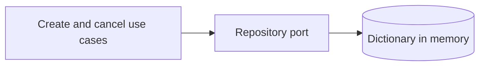
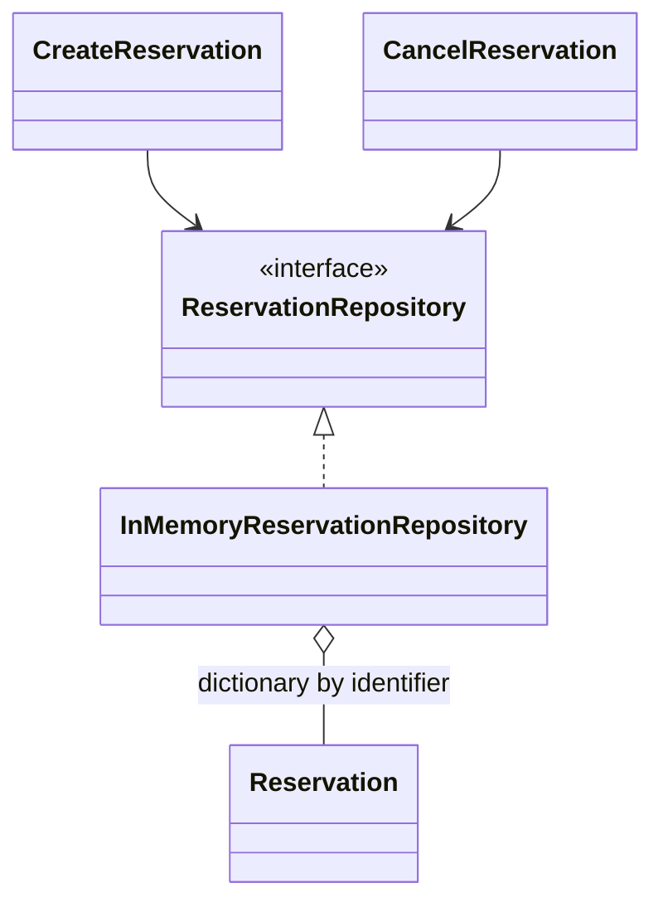
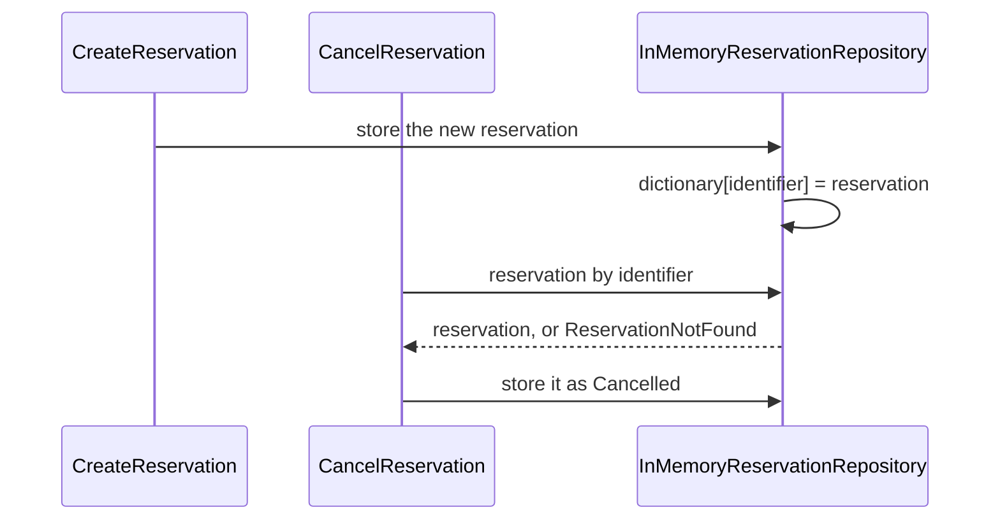

# ADR-BKG-002: Initial reservation storage

Motivated by: RQ-BKG-002, RQ-BKG-003, RQ-BKG-005 (FTR-BKG-001); builds on ADR-BKG-001.

## Status
Accepted

## Context
The first increments of the booking service need a repository quickly, to prove the rules. No requirement
asks for durability yet.

## Decision

### DEC-BKG-003: In-memory dictionary for reservations
- **Statement**: The repository adapter SHALL use a dictionary in memory, keyed by identifier behind the repository port of DEC-BKG-001, for storing reservations.
- **Rationale**: it is enough to deliver RQ-BKG-002, RQ-BKG-003 and RQ-BKG-005 and to test them; no requirement asks for durability yet.

## Consequences
- No file or database code, so the first increments are fast.
- Every reservation is lost at restart: acceptable for a demonstration only.
- The port makes a durable adapter a later addition.

## Alternatives Considered
- A JSON file from the start: rejected for now, durability is not yet a requirement.
- A relational database: rejected, a new dependency for a four-person pilot.

## Diagram

