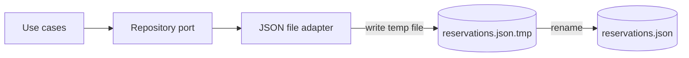
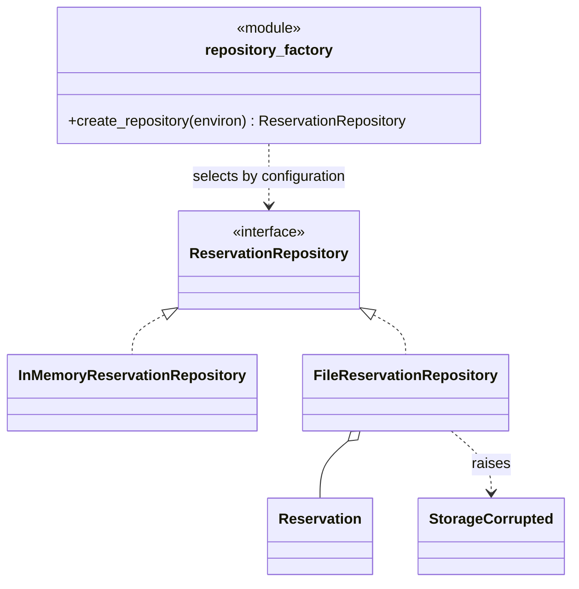
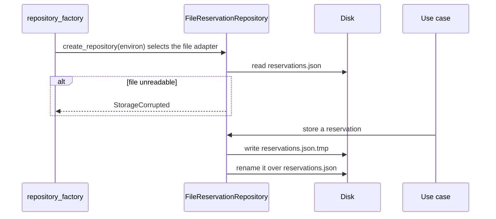

# ADR-BKG-003: Durable reservation storage

Motivated by: RQ-BKG-007 (FTR-BKG-002); supersedes ADR-BKG-002.

## Status
Accepted

## Context
The first demonstration lost every reservation at restart, which RQ-BKG-007 now forbids. The repository
port of ADR-BKG-001 allows another adapter. The pilot has one service process and fewer than 1000
reservations per month.

## Decision

### DEC-BKG-004: Atomic JSON file for reservations
- **Statement**: A second repository adapter, selected by a configuration value, SHALL use one JSON file, read at start and rewritten on every change through a temporary file renamed over it, for storing reservations; it replaces DEC-BKG-003.
- **Rationale**: the rename leaves the previous file intact when a save is interrupted; one service process and fewer than 1000 reservations per month need no database server.

## Consequences
- Reservations survive restarts without a database server.
- Every change rewrites the whole file: fine for the pilot volume, a limit if it grows.
- A corrupted file is detected at start and reported by a dedicated error.

## Alternatives Considered
- SQLite: rejected for now, a schema and migrations for a small volume.
- Append-only journal: rejected, replay and compaction code for no present need.

## Diagram

