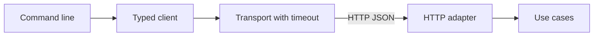
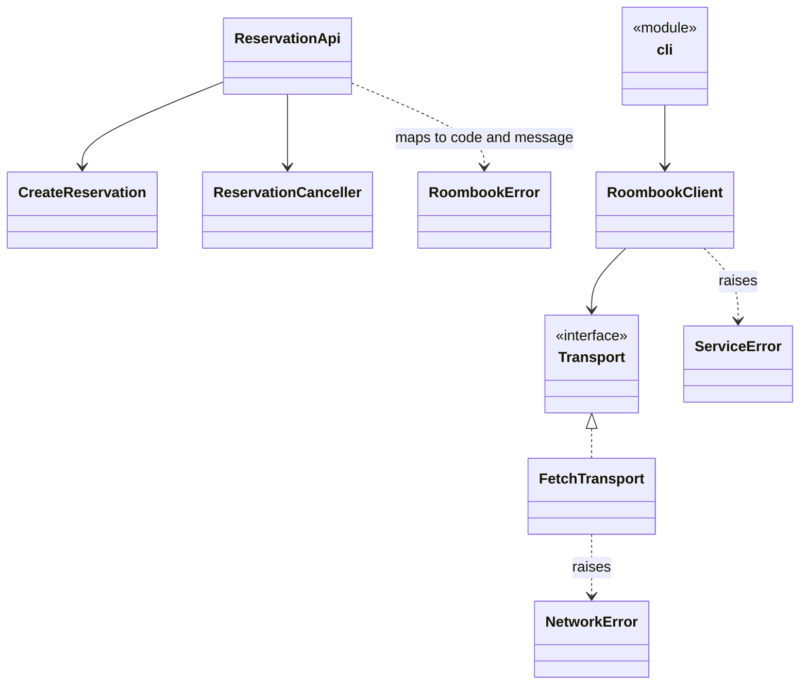
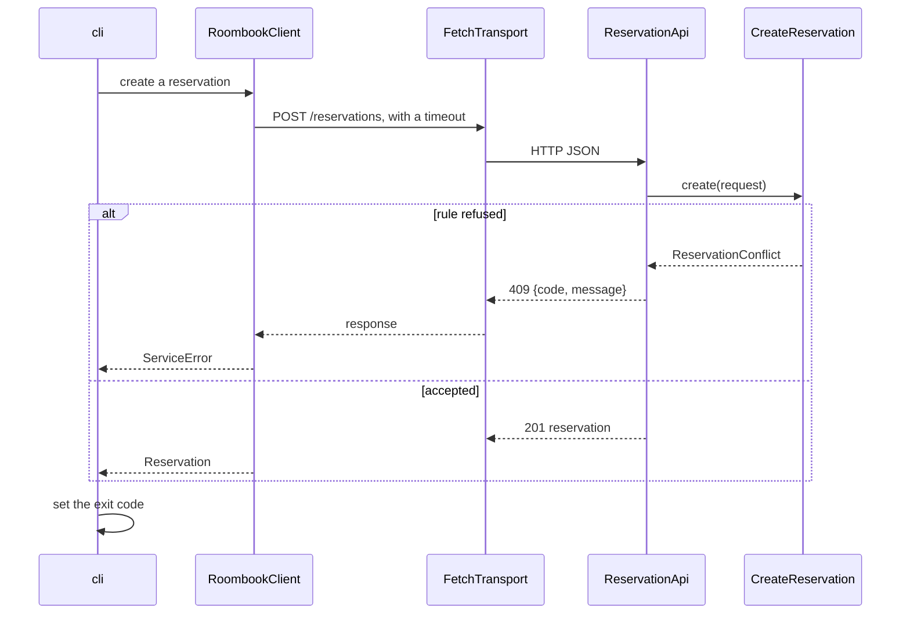

# ADR-CLI-001: Service access contract

Motivated by: RQ-CLI-001 to RQ-CLI-005 (FTR-CLI-001); builds on ADR-BKG-001.

## Status
Accepted

## Context
A TypeScript client and a command-line tool must call the Python service. The contract has to be simple,
testable on both sides, and independent of any web framework.

## Decision

### DEC-CLI-001: JSON routes with one error shape
- **Statement**: The service's HTTP adapter, on the Python standard library, SHALL expose `GET /rooms` (200), `POST /reservations` (201) and `DELETE /reservations/{id}` (204), every error as a JSON body `{code, message}` with 404 (unknown room or reservation), 409 (conflict, already-started reservation) or 422 (capacity, closed room), for translating requests and errors while the logic stays in the use cases.
- **Rationale**: a small contract is testable on both sides with a fake transport, and three routes need no web framework.

### DEC-CLI-002: Three-layer client
- **Statement**: The client SHALL apply three layers, a transport that calls with a timeout and raises a network error, a typed client that maps responses and error bodies to types and a service error, and a command-line tool that only parses arguments, calls the client and sets the exit code, for testing each concern alone.
- **Rationale**: each layer gets its own tests, the command line holds no logic, and an OpenAPI generator would be heavier than the contract.

## Consequences
- The contract is small and can be tested with a fake transport.
- No framework means no routing library; the adapter is a few dozen lines.
- Three layers on the client side, each with its own tests.

## Alternatives Considered
- A web framework on the service side: rejected, a dependency for three routes.
- Generating the client from an OpenAPI file: rejected, tooling heavier than the contract.

## Diagram

