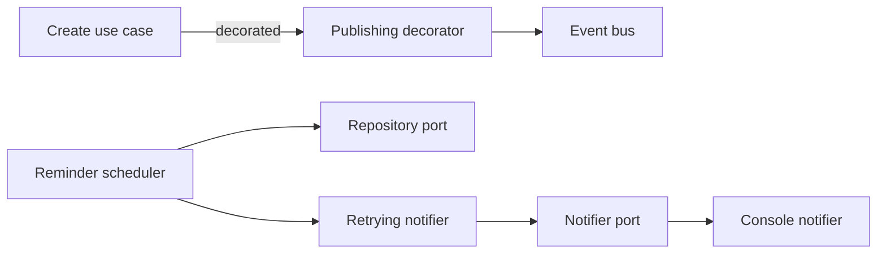
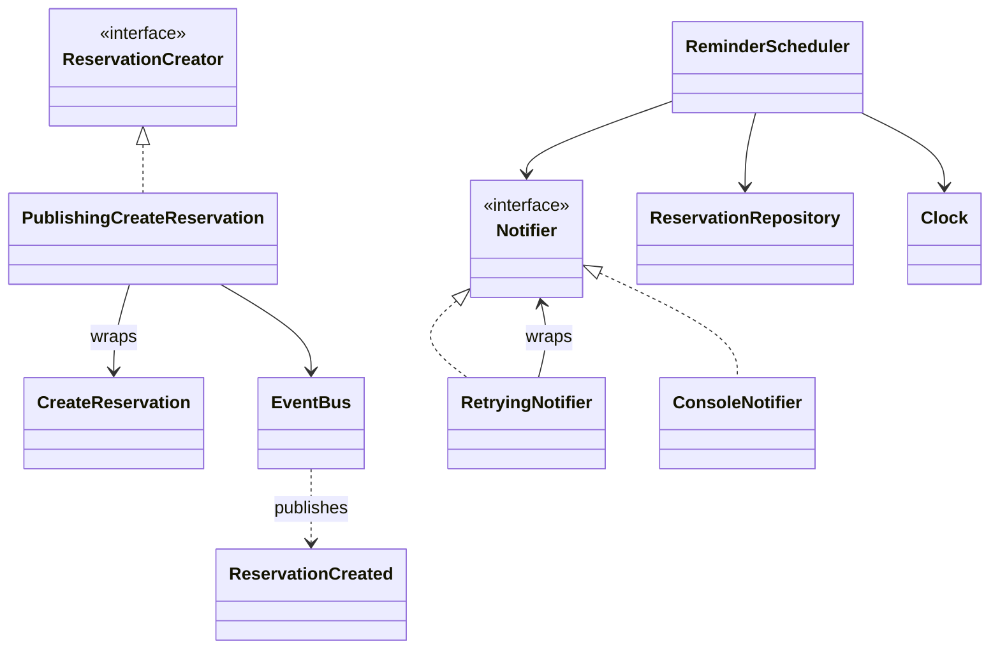
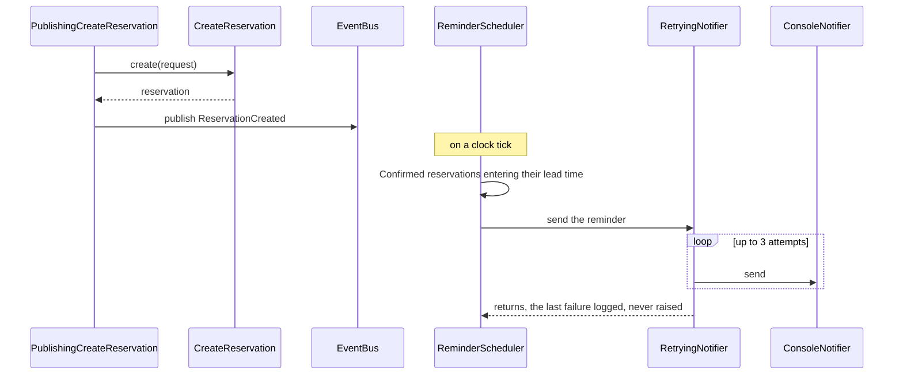

# ADR-NTF-001: Reminder event flow

Motivated by: RQ-NTF-001, RQ-NTF-002, RQ-NTF-003, RQ-NTF-004 (FTR-NTF-001); builds on ADR-BKG-001.

## Status
Accepted

## Context
Reminders must react to reservations without the booking code knowing about notifications, and the way a
reminder is delivered (console today, mail later) must be replaceable. Delivery can fail and must not
break a booking.

## Decision

### DEC-NTF-001: Publishing decorator over an in-process bus
- **Statement**: A decorator of the create-reservation use case SHALL publish the reservation-created event on an in-process event bus, after the wrapped call succeeds, for announcing reservations without changing the use case.
- **Rationale**: the booking code must not know about notifications; one process needs no broker.

### DEC-NTF-002: Retrying decorator over a notifier port
- **Statement**: The reminder scheduler SHALL use a notifier port, wrapped by a retrying decorator that calls the real notifier up to 3 times, logs the final failure and never raises, for sending one reminder per Confirmed reservation entering its lead time, read from the repository on a clock tick.
- **Rationale**: the delivery channel (console today, mail later) must be replaceable, and a failed delivery must not break a booking (RQ-NTF-003).

## Consequences
- Booking code is untouched by this feature (DEC-BKG-002 spirit).
- Events are lost if the process stops between creation and publication: acceptable for reminders.
- Delivery channels can be added behind the port; retry behavior stays in one place.

## Alternatives Considered
- Message broker: rejected, an external dependency for one process.
- Calling the notifier inside the use case: rejected, the use case would know delivery and retries.

## Diagram

