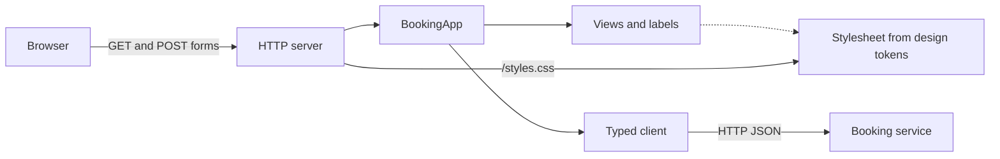
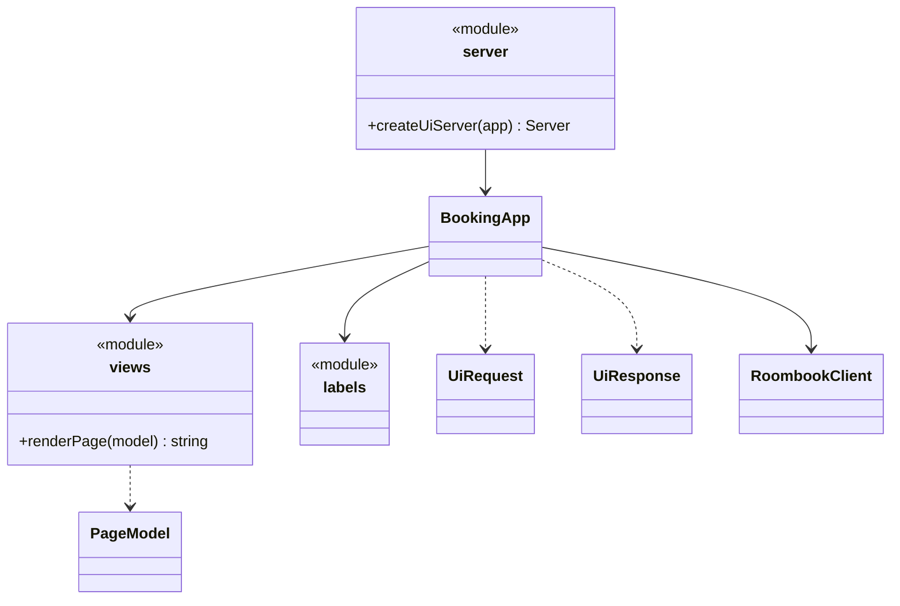
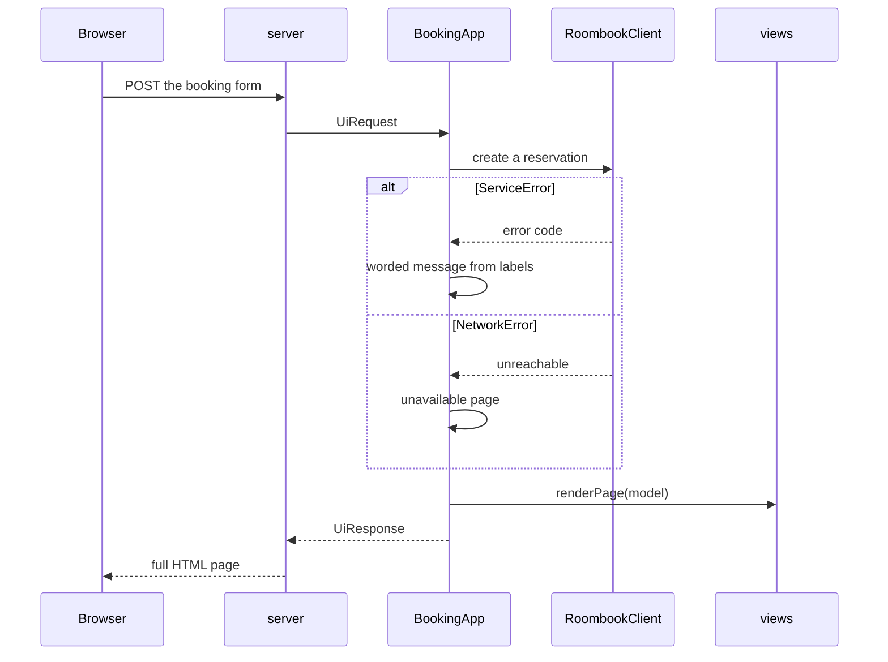

# ADR-WEB-001: Web interface rendering

Motivated by: RQ-WEB-001 to RQ-WEB-006 (FTR-WEB-001); builds on ADR-CLI-001 and on the design system ADR-DSN-001 (DEC-DSN-001, DEC-DSN-002).

## Status
Accepted

## Context
Office staff need a browser interface to the booking service. The team already has a typed client
(ADR-CLI-001) and a design system whose stylesheet is generated from tokens (ADR-DSN-001). The interface has
one page with three cards and the project avoids heavy dependencies.

## Decision

### DEC-WEB-001: Server-rendered HTML on Node `http`
- **Statement**: The interface SHALL use pure view functions returning HTML strings, served by a Node `http` server that only translates HTTP to a request object and back, with URL-encoded form posts answered by a full page and no browser script, for rendering the pages; every visible class name is declared once and styled by the stylesheet of DEC-DSN-002.
- **Rationale**: three forms do not justify a framework or a browser build chain, and the views hold no visual value.

### DEC-WEB-002: Booking application over the typed client
- **Statement**: A `BookingApp` SHALL apply the `RoombookClient` to a request object, mapping form values to a reservation request, service error codes to worded messages of one labels module and a network error to an unavailable page, for keeping the server and the views ignorant of the service contract; times typed carry no zone and are booked in UTC.
- **Rationale**: the logic is testable without a browser or a socket, and no requirement asks for time zones yet.

## Consequences
- Logic, views and server are testable without a browser or a socket, except one test of the server itself.
- No framework to maintain; the cost is hand-written HTML escaping, covered by tests.
- Every action reloads the page, which is acceptable for a booking form.
- The booking offset is fixed to UTC until a requirement asks for time zones.

## Alternatives Considered
- A single-page application with a framework: rejected, a build chain and dependencies for three forms.
- Adding HTML routes to the Python service: rejected, it would couple presentation to the domain service
  and bypass the typed client.
- Browser-side script calling the JSON API directly: rejected, it needs the API to allow cross-origin calls
  and a TypeScript build for the browser.

## Diagram

